# Handwritten Character Recognition

**CodeAlpha Machine Learning Internship — Task 3**

[](https://colab.research.google.com/github/Nandishsk-07/CodeAlpha_HandwrittenCharacterRecognition/blob/main/CodeAlpha_HandwrittenCharacterRecognition.ipynb)

A deep learning project that recognises **handwritten digits and letters** from 28×28 images using a **Convolutional Neural Network (CNN)**. It is trained and evaluated on two datasets: **MNIST** (10 digits) and **EMNIST Balanced** (47 classes: digits and letters).

| Dataset | Classes | Baseline MLP | **CNN** |
|---|---|---|---|
| MNIST | 10 | 97.84% | **99.29%** |
| EMNIST Balanced | 47 | 83.76% | **88.62%** |

*(Test-set accuracy.)*

---

## Table of Contents
- [Overview](#overview)
- [Datasets](#datasets)
- [Workflow](#workflow)
- [Model](#model)
- [Results](#results)
- [Error Analysis](#error-analysis)
- [Key Insights](#key-insights)
- [Try It on Your Own Handwriting](#try-it-on-your-own-handwriting)
- [Limitations and Future Work](#limitations-and-future-work)
- [How to Run](#how-to-run)
- [Tech Stack](#tech-stack)
- [Project Structure](#project-structure)
- [Author](#author)

---

## Overview

The goal is to identify which character is shown in an image of handwriting. The project works in two stages:

1. **MNIST (warm-up):** digits 0–9, a classic benchmark that shows the CNN pipeline works.
2. **EMNIST Balanced (main task):** 47 classes covering digits and letters, a much harder and more realistic *character* recognition problem, because several characters look almost identical (0 / O, 1 / I / L, 9 / q).

**Highlights**
- Baseline **MLP vs CNN** comparison on both datasets
- Data augmentation (small rotations, zoom and shifts; no flips, since they would turn *b* into *d*)
- Detailed evaluation: per-class F1, 47×47 confusion matrix, most-confused pairs, misclassified gallery
- Preprocessing function that converts **real photos or drawings** into the dataset format for live prediction
- Optional Gradio drawing canvas for an interactive demo

## Datasets

| | MNIST | EMNIST Balanced |
|---|---|---|
| Content | Handwritten digits | Handwritten digits + letters |
| Classes | 10 | 47 |
| Image size | 28×28, grayscale | 28×28, grayscale |
| Training images | 60,000 (54,000 train / 6,000 validation) | 112,800 (101,520 train / 11,280 validation) |
| Test images | 10,000 | 18,800 (400 per class) |
| Loaded with | `tf.keras.datasets.mnist` | `tensorflow_datasets` (`emnist/balanced`) |

- **Why 47 classes?** EMNIST Balanced merges upper- and lower-case versions of letters that look nearly identical (C, I, J, K, L, M, O, P, S, U, V, W, X, Y, Z) into one class. Only 11 letters keep a separate lower-case class (a, b, d, e, f, g, h, n, q, r, t).
- **Balanced classes:** every class has the same number of images, so plain accuracy is a fair metric.
- **Orientation fix:** EMNIST images are stored rotated and mirrored. The notebook shows the raw and transposed images side by side and transposes them to the upright orientation.

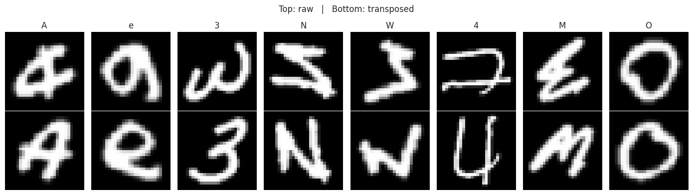

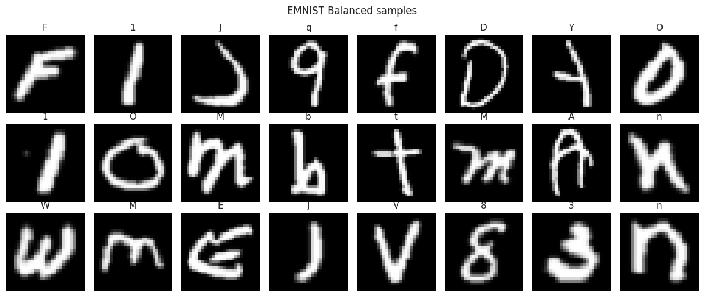

## Workflow

1. **Load** MNIST and EMNIST Balanced and inspect shapes, pixel ranges and class counts
2. **Fix EMNIST orientation** (transpose)
3. **Preprocess:** scale pixels to 0–1, reshape to `(28, 28, 1)`, hold out 10% of the training data for validation (stratified); the official test set is used only for the final scores
4. **Augment** (inside the model, active only during training): rotation about ±10°, zoom 10%, shift 10%
5. **Train a baseline MLP** and the **CNN** on each dataset with `EarlyStopping` and `ReduceLROnPlateau`
6. **Evaluate:** accuracy, macro F1, classification report, confusion matrix, per-class F1, most-confused pairs, misclassified examples
7. **Predict on real images** with a preprocessing function (grayscale → invert if needed → crop → centre → resize to 28×28)
8. **Save** the trained models and class labels

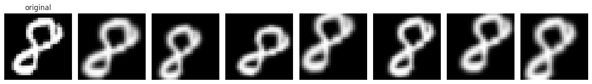

## Model

**CNN architecture**

```
[Augmentation: RandomRotation → RandomZoom → RandomTranslation]   (training only)
Conv2D(32, 3×3) → BatchNorm → ReLU
Conv2D(32, 3×3) → BatchNorm → ReLU → MaxPool → Dropout(0.25)
Conv2D(64, 3×3) → BatchNorm → ReLU
Conv2D(64, 3×3) → BatchNorm → ReLU → MaxPool → Dropout(0.25)
Flatten → Dense(256, ReLU) → Dropout(0.5) → Dense(num_classes, softmax)
```

- Optimiser: Adam (learning rate 1e-3, reduced automatically on plateau)
- Loss: sparse categorical cross-entropy; batch size 128
- **Baseline MLP:** Flatten → Dense(256) → Dropout(0.3) → Dense(128) → softmax. It ignores the 2-D structure of the image, which shows how much the convolutions help.

## Results

Metrics on the official test sets:

| Dataset | Model | Accuracy | Macro F1 |
|---|---|---|---|
| MNIST | MLP (baseline) | 0.9784 | 0.9783 |
| MNIST | **CNN** | **0.9929** | **0.9930** |
| EMNIST Balanced | MLP (baseline) | 0.8376 | 0.8361 |
| EMNIST Balanced | **CNN** | **0.8862** | **0.8843** |

Random guessing would score 10% on MNIST and 2.1% on EMNIST Balanced.

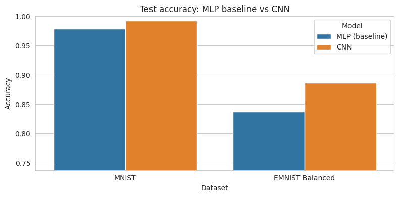

### Training curves (EMNIST CNN)
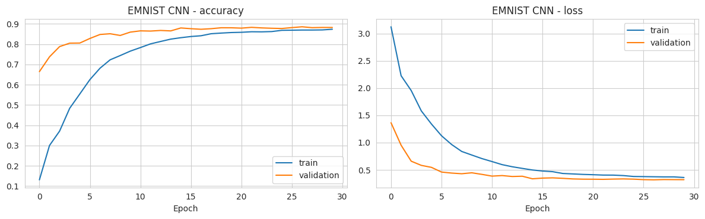

### MNIST
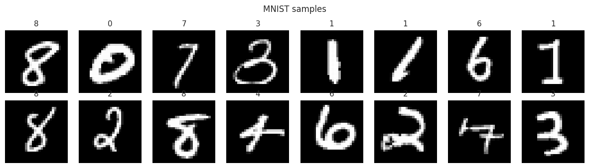

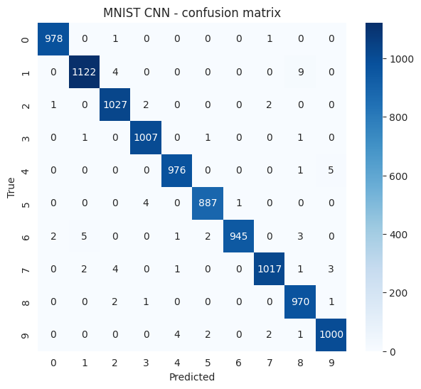

### EMNIST Balanced
**F1-score per character** (red = below 0.80):

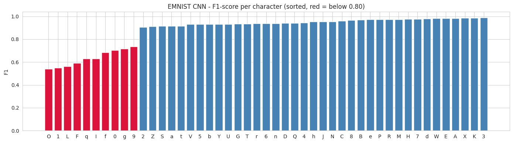

**Confusion matrix** (row-normalised):

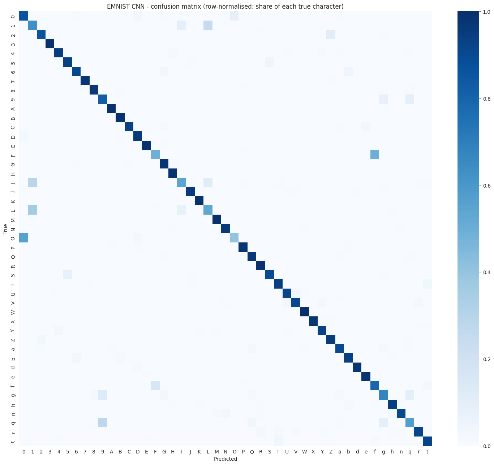

## Error Analysis

Most-confused pairs on the EMNIST test set (each class has 400 test images):

| True character | Predicted as | Times |
|---|---|---|
| O | 0 | 222 |
| F | f | 198 |
| L | 1 | 145 |
| I | 1 | 117 |
| q | 9 | 112 |
| 1 | L | 101 |
| f | F | 65 |
| g | 9 | 53 |
| I | L | 46 |
| 2 | Z | 45 |
| g | q | 39 |
| 9 | q | 39 |

**Hardest characters (F1):** O (0.54), 1 (0.55), L (0.56), F (0.59), q (0.63), I (0.63), f (0.69), 0 (0.70), g (0.72), 9 (0.74).
**Easiest characters:** 3 (0.99), K (0.99), X (0.99), A (0.98), E (0.98), W (0.98).

Misclassified examples (true vs predicted, with model confidence):

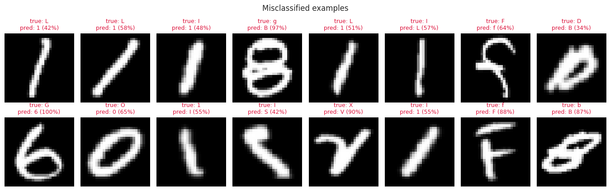

## Key Insights

- **The CNN clearly beats the MLP:** on MNIST the error rate drops from 2.16% to 0.71% (about three times fewer mistakes), and on EMNIST Balanced it drops from 16.2% to 11.4%.
- **EMNIST is much harder than MNIST** (88.6% vs 99.3%). The gap comes mostly from genuinely ambiguous shapes rather than model weakness.
- **Errors are concentrated in a few look-alike groups:** 37 of the 47 classes reach an F1 of 0.90 or higher, while only 10 classes fall below 0.80. These are the ambiguous ones: the letter O vs the digit 0 (more than half of the test "O" images were predicted as 0), I / L / 1, F vs f, and q / g / 9. Many of these are hard even for a human without context.
- **No overfitting:** the final training accuracy (87.4%) is slightly *below* the validation accuracy (88.2%), because augmentation and dropout make training harder. The validation loss had nearly flattened by epoch 30 after the learning rate was reduced, so longer training would bring at most a small gain. (No ablation was run, so the exact benefit of augmentation was not measured.)
- **Model confidence reflects ambiguity:** in the prediction demo, an unambiguous "t" and "T" were predicted with 96% and 98% confidence, while a "9" got only 73.5% confidence with "q" as the runner-up.

## Try It on Your Own Handwriting

`preprocess_image()` and `predict_character()` in the notebook turn a normal photo (dark ink on light paper) into the dataset format: grayscale → invert if needed → crop to the strokes → centre with a margin → resize to 28×28. Write one large character in black pen on white paper, upload the photo, and the model returns its top-3 guesses with confidence.

Example predictions on test images converted into "photos":

| | | |
|---|---|---|
| 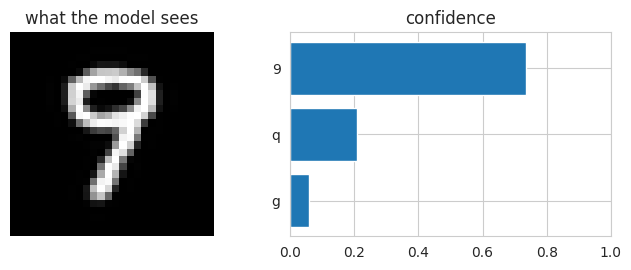 | 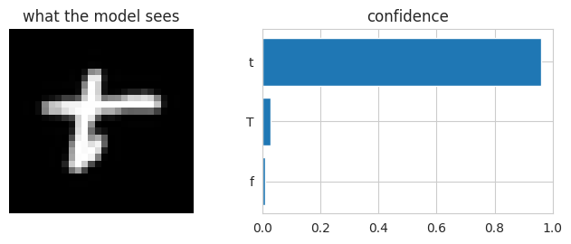 | 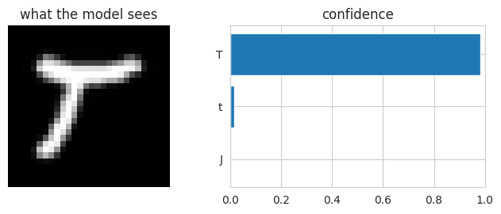 |

The notebook also includes an optional **Gradio drawing canvas**: draw a character with your mouse and see live predictions (run the last cell of Part C after `pip install gradio`).

> Because EMNIST Balanced merges some upper/lower-case letters, a prediction like "C" can mean either *c* or *C*.

## Limitations and Future Work

- The model recognises **one centred character at a time**; photos of real handwriting can differ from the dataset (stroke thickness, lighting, cropping).
- Ambiguous classes (O/0, I/L/1, F/f) limit accuracy without surrounding context.
- Future work:
  - Recognise full **words** with a CRNN and CTC loss, and automatically segment characters from a line of text
  - Try deeper architectures (ResNet) or ensembles to push accuracy higher
  - Add context (for example a language model) to resolve O vs 0
  - Deploy the Gradio demo (for example on Hugging Face Spaces)

## How to Run

**Option 1: Google Colab (recommended)**
1. Click the **Open in Colab** badge above
2. Choose **Runtime → Change runtime type → T4 GPU**
3. Choose **Runtime → Run all**. No dataset upload is needed: MNIST loads through Keras and EMNIST downloads through `tensorflow_datasets` (about 0.5 GB the first time).
4. If loading EMNIST fails with an `importlib_resources` error, run `!pip install importlib_resources` and re-run that cell.

**Option 2: Locally**
```bash
git clone https://github.com/Nandishsk-07/CodeAlpha_HandwrittenCharacterRecognition.git
cd CodeAlpha_HandwrittenCharacterRecognition
python -m venv venv
venv\Scripts\activate        # Mac/Linux: source venv/bin/activate
pip install -r requirements.txt
jupyter notebook
```
Open the notebook and run all cells. A GPU is recommended; on a CPU the EMNIST CNN will be considerably slower.

## Tech Stack

- Python 3.10+
- TensorFlow / Keras
- TensorFlow Datasets
- NumPy, Pandas
- Scikit-learn
- Matplotlib, Seaborn
- Pillow
- Gradio (optional demo)
- Jupyter / Google Colab

## Project Structure

```
CodeAlpha_HandwrittenCharacterRecognition/
├── CodeAlpha_HandwrittenCharacterRecognition.ipynb   # main notebook
├── README.md
├── requirements.txt
└── images/
    ├── mnist_samples.png
    ├── mnist_confusion_matrix.png
    ├── emnist_samples.png
    ├── emnist_orientation_check.png
    ├── augmentation_preview.png
    ├── emnist_cnn_history.png
    ├── results_summary.png
    ├── emnist_per_class_f1.png
    ├── emnist_confusion_matrix.png
    ├── emnist_misclassified.png
    └── demo_1.png, demo_2.png, demo_3.png
```

## Author

**Nandish**
- GitHub: [@Nandishsk-07](https://github.com/Nandishsk-07)
- LinkedIn: [@Nandish SK](www.linkedin.com/in/nandish-sk-311061360)

## Acknowledgements

- Internship by [CodeAlpha](https://www.codealpha.tech)
- Datasets: *MNIST* (LeCun et al.) and *EMNIST* (Cohen et al., 2017)
